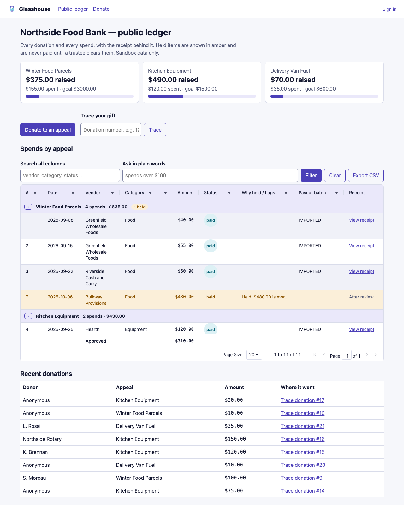
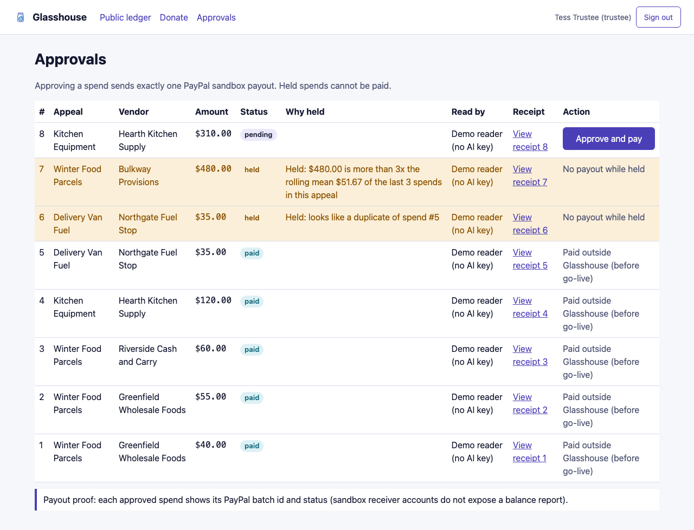
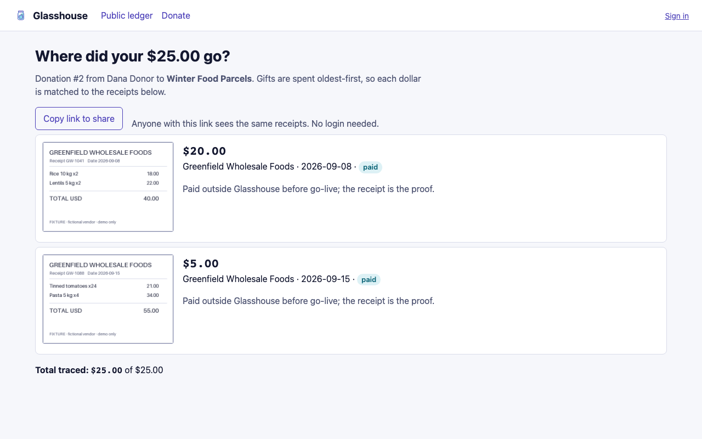
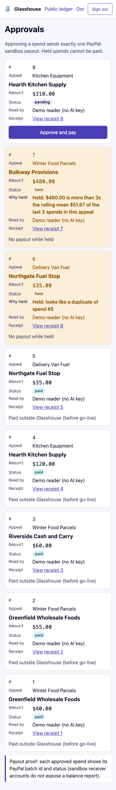

# Glasshouse

Glasshouse is a glass-walled ledger for small charities: donors give through PayPal, volunteers upload receipts, and trustees approve each spend before a PayPal payout goes out.
Every donation is matched first-in-first-out to the spends it paid for, so any donor can open "where did my $25 go?" and see the exact receipts.
Spends that look like duplicates, go over an appeal's per-item cap, or run above 3x the appeal's rolling mean are held in amber and never paid.

**Sandbox only.** All PayPal calls go to `api-m.sandbox.paypal.com`; no real money moves.

**Who reads the receipts.** With `ANTHROPIC_API_KEY` set, Claude (vision, JSON schema) reads each receipt. Without a key, a deterministic demo reader answers from `data/fixtures/manifest.json` by image hash, and every row says "Demo reader (no AI key)". The screenshots below were taken without a key.

- Demo video: _(placeholder — link added after recording)_
- Hosted demo: _(placeholder — sandbox URL added after deploy)_

## Judge walkthrough (about 5 minutes)

1. Open `/`, the public ledger, with no login. Three appeals with raised / spent / goal, every spend with its receipt, held spends in amber with the reason.
2. Click **Trace** with donation `2`, or open `/trace/2`. "Where did your $25.00 go?" lists the receipts that gift paid for; the total always equals the gift. **Copy link to share** gives a link anyone can open.
3. **Donate to an appeal**: pick $10 / $25 / $50 and pay with a PayPal sandbox buyer. You land on your own trace page, and the gift is in the public ledger within seconds. Signed-in donors can tick "Show my name"; everyone else is Anonymous.
4. Sign in as the volunteer, open **Upload receipt**, click **Download a sample receipt to try**, then upload it. It is read and lands as a pending spend (or held, if it trips a rule).
5. Sign in as the trustee, open **Approvals**. Held spends sit on top with the reason and "No payout while held". **Approve and pay** on spend #8 sends exactly one PayPal sandbox payout and shows its batch id and status.
6. Back on `/`, the paid spend shows its payout batch. Held and pending receipt images stay trustee-only until approved.

## Demo logins (password `glasshouse-demo`)

| Role | Email |
|---|---|
| Donor | donor@northside.test |
| Volunteer | volunteer@northside.test |
| Trustee | trustee@northside.test |

## Screens

Public ledger: 

Trustee approvals (held spends first, one payout per approval): 

Donor trace with shareable link: 

Phone view of approvals: 

## Architecture

```text
Browser ── Next.js 16 app router (pages + /api routes, React 19, AG Grid Community)
  /donate ─► api/donate ─► lib/paypal.ts  Orders v2 create/capture (sandbox host is a constant)
  PayPal return ─► api/donate/return ─► capture (idempotent on order id) ─► donation row
  /volunteer ─► api/receipts ─► lib/extract.ts (Claude vision | demo reader) ─► lib/anomaly.ts hold rules
  /trustee ─► api/spends/[id]/approve ─► lib/gate.ts (only path to money) ─► Payouts v1, one batch per spend
  api/payouts/[id]/poll ─► batch status SUCCESS ─► spend "paid"
  lib/allocation.ts  pure FIFO, integer cents: donation -> spends; /trace/[id] sums exactly
  lib/ledger.ts  every money move; node:sqlite single file data/glasshouse.db
  lib/auth.ts  scrypt passwords, HMAC-signed HttpOnly cookie (Secure on https)
  lib/ratelimit.ts  per-IP limits on donate, capture, NL filter (rate-limiter-flexible)
```

## Run (development)

```bash
npm ci
cp .env.example .env.local   # fill in sandbox PayPal client id/secret and SESSION_SECRET (openssl rand -hex 32)
npm run seed                 # Northside Food Bank: 3 appeals, 21 donations, 8 receipts
npm run dev                  # http://localhost:3000
```

## Run the production build

```bash
npm ci && npm run seed
npm run build
APP_ORIGIN=http://127.0.0.1:3000 PORT=3000 npm start
```

Production refuses to start without one of two settings, because the rate limit is keyed on the client IP:
`ALLOW_SHARED_RATE_LIMIT=1` (already in `.env.example`; single-user demo, all callers share one bucket), or `TRUST_PROXY=1` when you run behind your own reverse proxy that appends the client IP to `X-Forwarded-For`.
`APP_ORIGIN` must be the public URL; PayPal return URLs and redirects use it, never the Host header. On `https` the session cookie is marked `Secure`.

## Tests

```bash
npm test                     # unit tests (vitest)
npx tsc --noEmit             # type check
npm run test:int -- http://127.0.0.1:PORT http://127.0.0.1:CDP  # live sandbox T4/T5/T7/T8/T9/T10 (fresh seed, running server)
URL=http://127.0.0.1:PORT OUT=../shots TRACE_ID=2 npm run test:e2e  # every page x 2 viewports, console, axe, watermark
```

## Notes

- `stubs/sharp` is an empty stand-in wired through `overrides` in package.json: the app serves receipts as plain PNGs and never uses Next image optimisation, so the native sharp binary is not needed in the build.
- Exact dependency versions are pinned (`.npmrc` has `save-exact=true`).
- Receipt fixtures are fictional vendors, marked "FIXTURE" on the image.

Licence: MIT.
